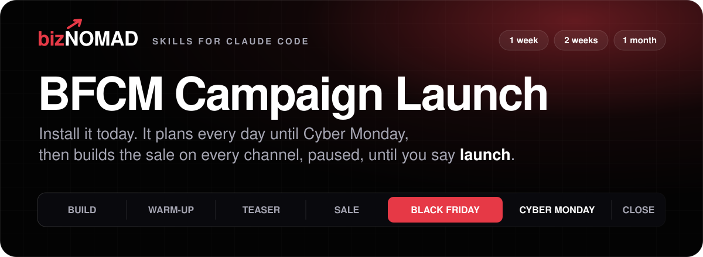
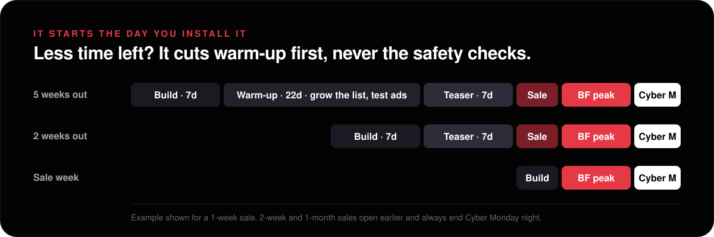
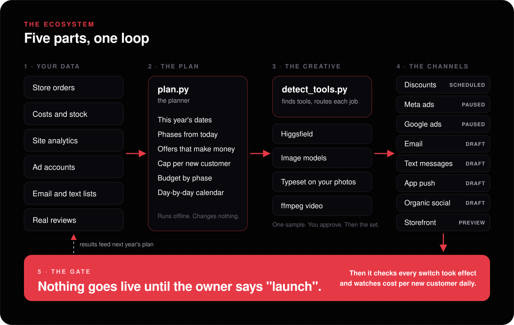
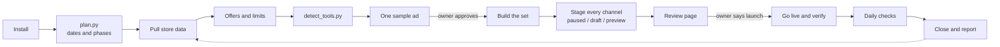

<p align="center">
  
</p>

<p align="center">
  
  
  
  
  
</p>

<h3 align="center">A Black Friday / Cyber Monday team in one Claude Code skill.</h3>

<p align="center">
It reads your store's numbers, sets offers that make money, makes the ads with the tools you already have,<br>
and stages every channel. Nothing goes live until you say <b>launch</b>.
</p>

<p align="center">
  <a href="#quick-start">Quick start</a> ·
  <a href="#what-it-can-do">What it can do</a> ·
  <a href="#the-ecosystem">The ecosystem</a> ·
  <a href="#the-plan-it-prints">Sample plan</a> ·
  <a href="#safety-rules">Safety rules</a>
</p>

---

## Quick start

```bash
git clone https://github.com/Biznomad/bfcm-campaign-launch ~/.claude/skills/bfcm-campaign-launch
```

Then, in Claude Code, inside your store's project:

```
/bfcm-campaign-launch
```

or just say **"plan my Black Friday"**. Claude copies the example config, asks only for what it can't look up, and shows you a plan before it builds anything.

Want to see the plan first, with no store connected?

```bash
cd ~/.claude/skills/bfcm-campaign-launch
python3 scripts/plan.py bfcm.config.example.json      # the plan from today
python3 scripts/detect_tools.py                       # the creative tools on this machine
```

Both scripts run offline, need no packages and change nothing.

## It starts the day you install it

<p align="center">
  
</p>

The planner works out this year's Black Friday and Cyber Monday, counts the days you have, and fills them:

| Phase | What happens | When there's little time |
|---|---|---|
| **Build** | Audit every channel, pull your data, set offers, make one sample ad, stage everything, walk the store on a phone | Squeezed into the days left. Never skipped |
| **Warm-up** | Grow the early-access list. Test ad concepts cheaply on your regular offer | Cut first |
| **Teaser** | The date goes public. The early-access list hears the offers the day before | Cut second |
| **Sale** | Opens to early access first, then everyone. A new angle every third day | |
| **Peak** | Thanksgiving to Sunday. Highest budget, checked twice a day | |
| **Cyber Monday** | Morning send, "ends tonight", close on time | |
| **Close** | Confirm everything ended, thank customers, report against the plan | |

Pick how long the sale runs with one line in the config. It always ends Cyber Monday night.

| `sale_length` | Sale opens | Suits |
|---|---|---|
| `1w` | Tuesday before Black Friday | Most stores. Short, strong urgency |
| `2w` | Two Tuesdays before | Big lists and buyers who take longer to decide |
| `1m` | Start of November | "All November" pricing. Needs new ads every week |

## What it can do

| | Capability | How |
|---|---|---|
| 📅 | **Plans from today to Cyber Monday** | `scripts/plan.py` finds the dates, phases and a task list for every day |
| 📊 | **Sets offers from your numbers, not guesses** | Pulls last year's sale, the last 90 days, costs, stock, ad results and list sizes. `references/data.md` says what each number decides |
| 💵 | **Shows what every order leaves you** | Price minus product cost, shipping and payment fees, for each offer. Flags any offer that loses money before ads |
| 🎯 | **Gives you a spending limit** | The most you can pay for a new customer, the break-even return on ad spend, and a budget split by phase |
| 🎨 | **Makes the ads with what you have** | `scripts/detect_tools.py` finds Higgsfield, image models and local tools, and picks the right one for each kind of ad |
| 🧩 | **Thinks in concepts** | Eleven ad concepts for the season, chosen from your best sellers, best past ads and real reviews |
| 🛒 | **Stages every channel** | Discounts, Meta ads, Google ads, email, texts, app push, social posts and the storefront, all paused, draft or on a preview theme |
| 📱 | **Tests like a shopper** | Walks the preview on a phone, taps every option and reads the cart after each tap |
| 🔒 | **Waits for you** | One review page with every asset, price and date. It flips nothing until you say "launch" |
| 🩺 | **Diagnoses a drop mid-sale** | A six-step check that tells a traffic change from a broken page before you spend more |
| 🧾 | **Closes and reports** | Confirms discounts ended and ads stopped, then reports results against the plan |

## The ecosystem

<p align="center">
  
</p>

The skill is small on purpose. It is a conductor: it brings its own planner and playbooks, then puts the tools and skills you already have to work in the right order.

### What ships in this repo

| Piece | Job |
|---|---|
| [`SKILL.md`](SKILL.md) | The run, phase by phase, and the rules that never bend |
| [`scripts/plan.py`](scripts/plan.py) | Dates, phases, what each order leaves, spending limit, budget split, daily calendar |
| [`scripts/detect_tools.py`](scripts/detect_tools.py) | Finds creative tools and says which to use for each job |
| [`references/data.md`](references/data.md) | What to pull from your analytics and what each number decides |
| [`references/phases.md`](references/phases.md) | What each phase is for and what to cut when time is short |
| [`references/creative.md`](references/creative.md) | The concept slate, tool routing and image checks |
| [`references/ads.md`](references/ads.md) | Account structure, keeping likes and comments on ads, daily checks |
| [`references/messaging.md`](references/messaging.md) | Email, text and push: build order and safe sending |
| [`references/diagnose.md`](references/diagnose.md) | Finding the cause when sales or add-to-cart drop |
| [`references/traps.md`](references/traps.md) | Platform quirks that cost a retry |

### What it picks up on your machine

It checks for these and uses the best one available. None are required.

| If you have | It uses it for |
|---|---|
| **Higgsfield** (its command-line tool or Claude skills) | Product-in-scene photos, and short video made from an approved still |
| **An OpenAI or Google image model** | Richer offer cards made from your real product photo |
| **A hosted model account** | Reference-image edits and image-to-video |
| **A browser skill** (or Chrome) | Typeset ads with exact prices, the phone walk of your store |
| **Pillow, ImageMagick, ffmpeg** | Typeset cards, resizing, simple video from stills |
| **Nothing at all** | Typeset ads on your own product photos. Enough for seven of the eleven concepts |

Why typeset first for prices? A price in an ad must be exact, and typeset text is never misspelled. Image models come in where they are strongest: scenes, lighting and motion.

### What it connects to, with your access

Your store, your ad accounts, your email and text platform, your reviews app. The skill holds no keys and no connectors of its own. Claude works through the access you have already given it, and the rules say credentials are never printed or copied.

### Its sibling

[`ecom-campaign-launch`](https://github.com/Biznomad/ecom-campaign-launch) runs any promotion the rest of the year: a weekly deal, a product launch, a seasonal sale, at 1 week, 2 weeks or a month. This skill is its Black Friday fork. Lessons from one feed the other: the concepts that win in October are the ads you start November with.

### How a run flows



## The plan it prints

<details open>
<summary><b>Example: installed five weeks before the sale, 1-week sale, made-up store</b></summary>

```text
Example Brand: Black Friday / Cyber Monday plan
Today 2027-10-18 | Black Friday 2027-11-26 | Cyber Monday 2027-11-29
Sale (1w): opens 2027-11-23, ends Cyber Monday 23:59 | 36 days until it opens

Phases
  build   2027-10-18 to 2027-10-24  (7 days)
  warmup  2027-10-25 to 2027-11-15  (22 days)
  teaser  2027-11-16 to 2027-11-22  (7 days)
  sale    2027-11-23 to 2027-11-24  (2 days)
  peak    2027-11-25 to 2027-11-28  (4 days)
  cyber   2027-11-29 to 2027-11-29  (1 days)
  close   2027-11-30 to 2027-12-06  (7 days)

Money left per order before ads
  Single           price $28.00  (30% off)  left $15.89  max cost per new customer $15.89  break-even return 1.76x
  Bundle of 3      price $66.00  (33% off)  left $40.79  max cost per new customer $40.79  break-even return 1.62x
  Subscription     price $59.00  left $33.99  max cost per new customer $80.60  (pays back by order 2; each renewal leaves $46.61)

Calendar
  Mon 2027-10-18  [build]
     - Audit every channel; pull last year's BFCM and the last 90 days (references/data.md)
  Tue 2027-10-19  [build]
     - Lock offers and caps from the data; run scripts/detect_tools.py; make ONE sample creative for approval
  ...
  Fri 2027-11-26  [peak]
     - ** BLACK FRIDAY **
     - Email: Black Friday (morning) + resend to non-openers (evening)
     - Text: Black Friday
     - Ads: peak budget; check spend and cost per new customer at midday and evening
```

</details>

Try any start day: `python3 scripts/plan.py bfcm.config.example.json --today 2027-11-20`. Add `--json` to feed the plan to another tool.

## Safety rules

These hold on every run. They are in [`SKILL.md`](SKILL.md), where Claude reads them first.

- **Staged, not live.** Ads are created paused. Emails, texts and posts are drafts. Store changes go on a preview theme.
- **You launch it.** The owner's word "launch" is the only thing that flips anything on.
- **No early promotion.** Sale prices appear nowhere before the day you approved. It checks the live site and every scheduled item.
- **No spend surprises.** It reads billing status and today's spend before any switch, and never raises a budget without your number.
- **Honest claims only.** Your exact offers and terms. No health claims, invented reviews, fake countdowns or free shipping a cart won't get.
- **Keys stay put.** Credentials are never printed and never copied between businesses.
- **It tells you what failed.** A step that was skipped or broke is reported as such.

## What you need

- [Claude Code](https://claude.com/claude-code), with access to your store, ad accounts and email platform.
- Python 3 for the two scripts.
- Optional: any of the creative tools above.

## Good to know

- The budget split and the concept guidance are starting points from agency practice. Your own account's results should overrule them, and the skill tells Claude to check.
- The planner is tested for every start date from July to January at all three sale lengths. A full run on your store depends on the access you give Claude.
- The example config uses made-up numbers. Put in your own before trusting any figure.

---

<p align="center">
  <b><span>biz</span>NOMAD</b> · Small Business Hero<br>
  <sub>Built by <a href="https://biznomad.io">Biznomad</a> for store owners who want an agency's process without the agency. MIT licensed.</sub>
</p>
